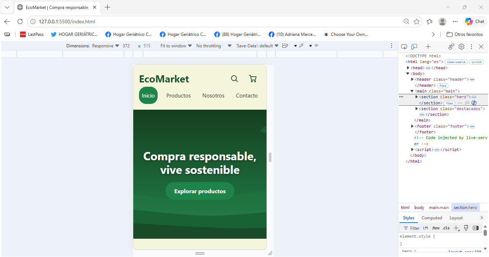
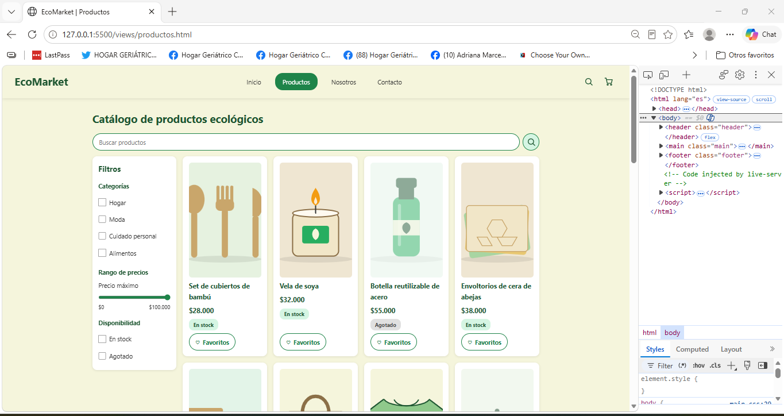
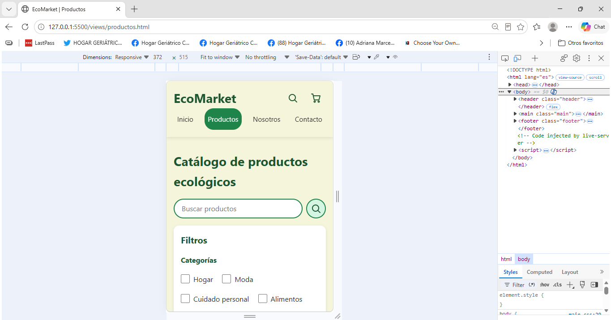
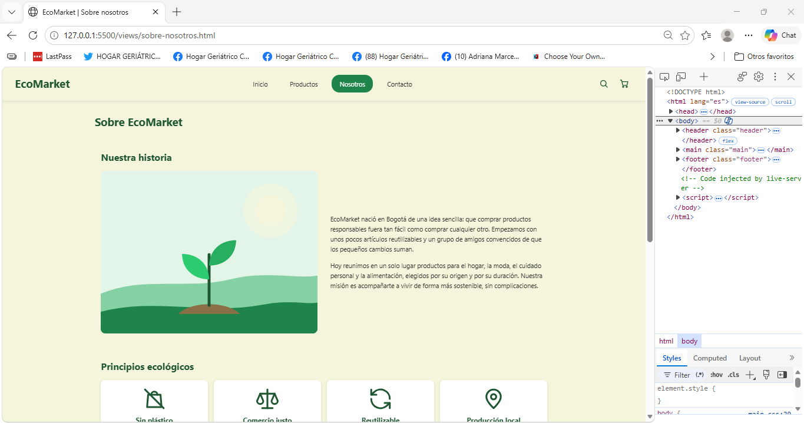
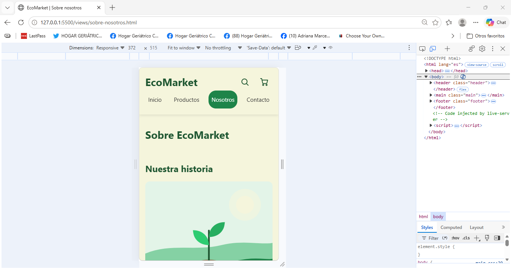
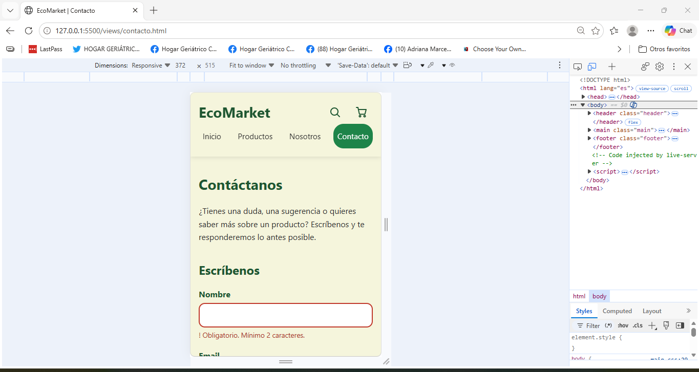

# EcoMarket

Tienda en línea de productos ecológicos, reutilizables y sustentables. Este proyecto es la maqueta web de EcoMarket: cuatro vistas responsivas hechas únicamente con **HTML5 semántico y CSS3 puro**, sin JavaScript ni librerías externas. Es un proyecto académico.

## Sitio publicado

- **Sitio web:** https://dev-jvelandia.github.io/EcoMarket_JuanVelandia/ 
- **Repositorio:** https://github.com/dev-JVelandia/EcoMarket_JuanVelandia

## Vistas

| Vista | Archivo | Qué incluye |
|---|---|---|
| Inicio | `index.html` | Header, hero con botón de acción, 6 productos destacados, footer |
| Productos | `views/productos.html` | Buscador visual, sidebar de filtros sticky, grid de 20 productos, paginación |
| Sobre nosotros | `views/sobre-nosotros.html` | Historia, principios ecológicos y carrusel de testimonios |
| Contacto | `views/contacto.html` | Formulario con validación visual, mapa estático y redes sociales |

## Capturas de pantalla

### Inicio

| Escritorio | Móvil |
|---|---|
|  |  |

### Productos

| Escritorio | Móvil |
|---|---|
|  |  |

### Sobre nosotros

| Escritorio | Móvil |
|---|---|
|  |  |

### Contacto

| Escritorio | Móvil |
|---|---|
|  |  |

## Tecnologías utilizadas

- **HTML5 semántico:** `header`, `nav`, `main`, `section`, `article`, `aside`, `address`, `figure` y `footer`.
- **CSS3 puro:** variables, Flexbox, Grid, media queries con enfoque mobile first, `scroll-snap`, transiciones y pseudo-clases (`:valid`, `:invalid`, `:checked`, `:hover`, `:focus-visible`).
- **Git y GitHub:** flujo GitFlow y Conventional Commits.
- **Despliegue:** GitHub Pages.
- **Sin JavaScript y sin frameworks ni librerías externas.**

## Instrucciones de visualización

**En línea:** abre el enlace del sitio publicado.

**En tu computador:**

```bash
git clone https://github.com/dev-JVelandia/EcoMarket_JuanVelandia.git
cd EcoMarket_JuanVelandia
```

Abre `index.html` en el navegador (doble clic) o, en VS Code, usa la extensión Live Server. No requiere instalar nada.

## Estructura del proyecto

```
EcoMarket/
├── css/
│   ├── main.css          # Reset, variables, tipografía
│   ├── layout.css        # Header, footer y sistemas de grid
│   ├── components.css    # Tarjetas, botones e inputs
│   └── animations.css    # Transiciones y animaciones
├── img/
│   ├── products/         # Ilustraciones de los 20 productos
│   ├── icons/            # Iconos, avatares y redes sociales
│   └── hero/             # Imágenes principales y mapa
├── views/
│   ├── productos.html
│   ├── sobre-nosotros.html
│   └── contacto.html
├── docs/capturas/        # Capturas de pantalla para este README
├── index.html
└── README.md
```

## Diseño

**Paleta de colores**

| Uso | Color |
|---|---|
| Verde principal | `#2ecc71` |
| Verde secundario | `#27ae60` |
| Beige de fondo | `#f5f5dc` |
| Verde oscuro (textos, footer) | `#1e5631` |
| Verde de botones | `#1e8449` |

**Tipografía:** fuente del sistema (`system-ui`) con tamaño base de 16 px, legible y sin cargar fuentes externas.

**Responsividad (mobile first):** los estilos base son para móvil y se amplían con `min-width` a 768 px (tablet) y 1024 px (escritorio). El catálogo pasa de 1 a 2 y a 4 columnas.

**Accesibilidad:** textos alternativos en las imágenes, formularios con etiquetas asociadas, foco visible con teclado, contraste de color revisado y respeto por `prefers-reduced-motion`.

## Interactividad solo con CSS

| Función | Técnica |
|---|---|
| Elevación de tarjetas al pasar el mouse | `transform` y `transition` |
| Botón Favoritos | Casilla oculta y selector `:checked` |
| Sidebar de filtros que acompaña el scroll | `position: sticky` |
| Carrusel de testimonios | `overflow-x` y `scroll-snap` |
| Validación del formulario | `:valid` y `:invalid` |
| Iconos de redes con escala al pasar el mouse | `transform: scale()` |

## Flujo de trabajo con Git

Se usó **GitFlow** con una rama por sección, que se fusionaron a `develop` y luego a `main`:

`feature/base` · `feature/home` · `feature/catalogo` · `feature/nosotros` · `feature/contact-form` · `feature/readme`

Los commits siguen **Conventional Commits**, por ejemplo:

```
feat(nosotros): agrega estructura HTML de sobre nosotros
style(contacto): agrega validación visual y botones de redes
docs: agrega README del proyecto
```

## Autor

Juan Diego Velandia · [dev-JVelandia](https://github.com/dev-JVelandia)
